# Screens

Every route of the application as implemented. Screenshots in [`screenshots/`](screenshots) are taken from the app
running against the mock (`SCREENSHOTS=1 bun run e2e e2e/screenshots.spec.ts` refreshes them). Operations per
route are listed in [`../../contracts/API_INTEGRATION.md`](../../contracts/API_INTEGRATION.md#screens-and-operations);
the rules behind each state are in [`../../docs/product/BUSINESS_RULES.md`](../../docs/product/BUSINESS_RULES.md).

Both workspaces share one shell: a sidebar with the role's sections and «Настройки», a header with breadcrumbs
(«Кабинет кандидата» or «Кабинет работодателя · company», then the section), the «Демо» button while the API runs in
mock mode, the candidate's invitation bell with the count of new invitations, and the account menu. Below 1024 px
the sidebar becomes a drawer opened from the header.

## Sign-in

### `/login` — «Вход и регистрация»

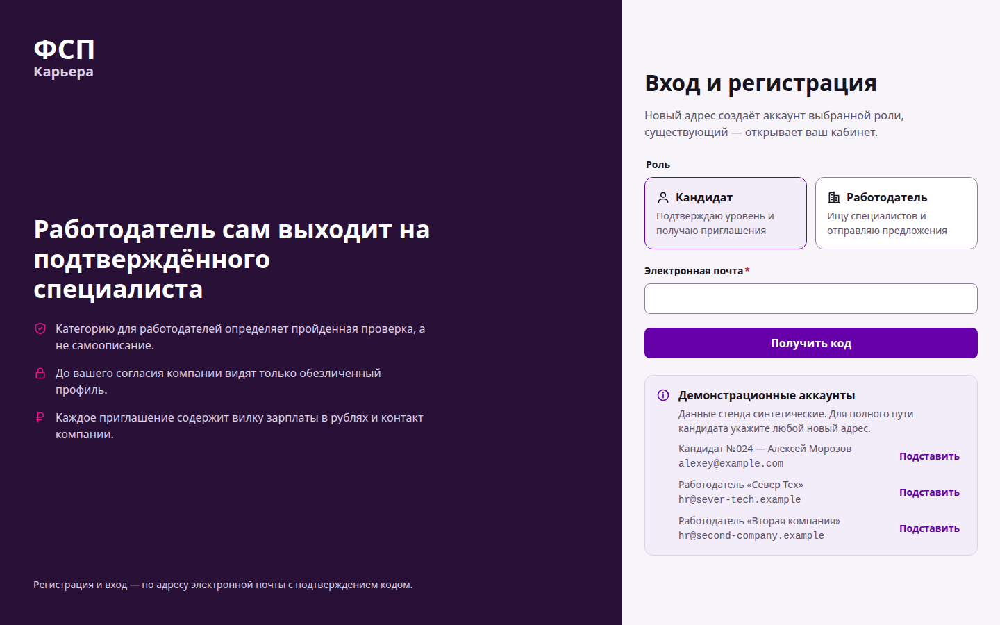

- Choose «Кандидат» or «Работодатель», enter an e-mail, «Получить код». A new address creates an account of that
  role; an address registered with the other role gets «Роль аккаунта изменить нельзя».
- Second step «Подтвердите почту»: six-digit code with its lifetime, «Подтвердить и войти», «Отправить новый код»,
  «Изменить почту». Wrong, expired, used and locked codes each get their own message and the resend button is
  highlighted.
- While codes go to the demo mailbox, a note says no letter is sent; on the stand it shows the code. In development
  «Вставить код из демо-ящика» fills it in. The demo-stand build lists the seed accounts with «Подставить».
- After a `401` elsewhere the page shows «Сессия завершилась»; an already signed-in visitor sees «Вы уже вошли» with
  «Перейти в кабинет» and «Выйти».

## Candidate

Navigation: Обзор, Профиль, Источники, Навыки, Проверки, Приглашения, Настройки.

### `/candidate/onboarding` — «Анкета кандидата»

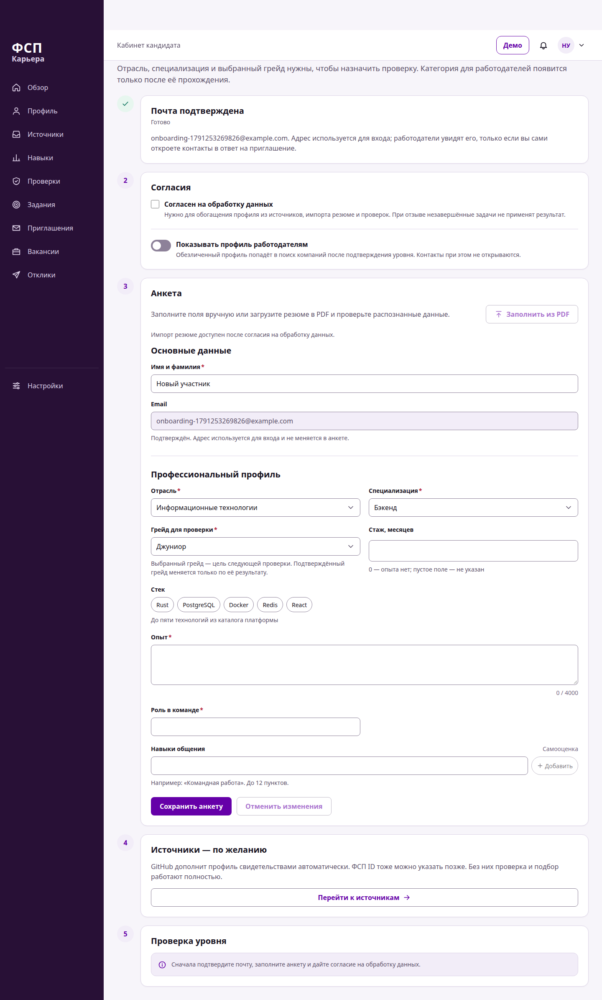

Five steps with done markers: e-mail confirmed; consents (processing and publication as separate controls);
questionnaire (the profile form, or «Заполнить из PDF» after processing consent); optional sources; level check.
The last step offers «Подтвердить уровень» for the saved target when the server allows it, otherwise the reason
(unsupported specialization, active attempt, cooldown, downgrade).

### `/candidate/overview` — «Мой профиль»

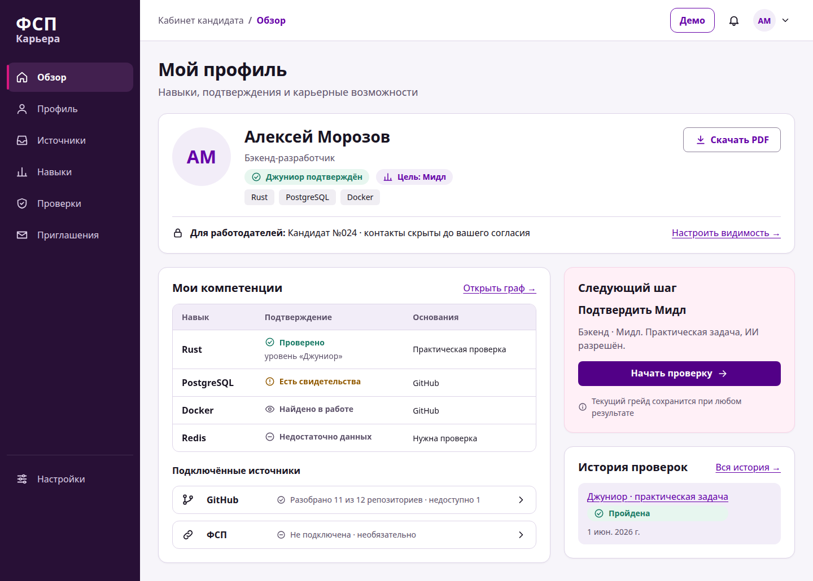

- Identity card: name, role, verified grade badge («Джуниор подтверждён» or «Уровень не подтверждён»), target badge
  («Цель: Мидл») when it differs, stack, «Скачать PDF», and the visibility line: the alias employers see, or the
  blockers that keep the profile out of search.
- «Начните с анкеты» while the questionnaire is incomplete.
- «Мои компетенции»: skills with state, confirmed level and evidence sources, plus a summary of GitHub and FSP.
- «Следующий шаг» (shared with «Проверки»): continue the questionnaire, continue an active attempt, open an
  evaluating one, start a check for the target, or the reason why not, with the date the cooldown ends.
- «История проверок»: the last three attempts.

### `/candidate/profile` — «Профиль и цели»

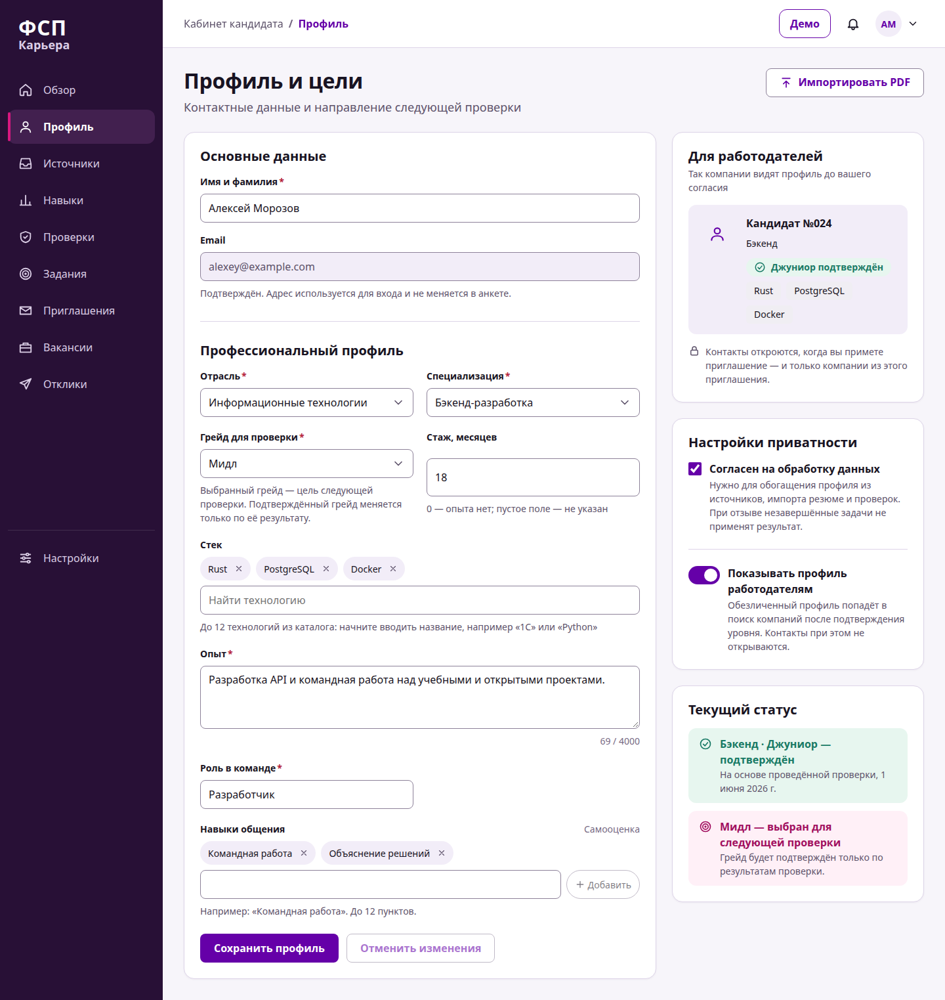

The profile form (name, read-only e-mail, industry, specialization, grade for the check, experience in months, stack
of up to five, experience, team role, soft skills) with «Сохранить профиль» and «Отменить изменения»; «Импортировать
PDF»; «Для работодателей» — the anonymous preview; privacy settings; «Текущий статус» with the verified grade and the
selected target shown separately.

PDF import is a dialog: choose a PDF (type and size checked first), wait for the job, review and edit the preview
(marked as a demo extraction), «Применить». Nothing changes until the candidate confirms.

### `/candidate/sources` — «Источники профиля»

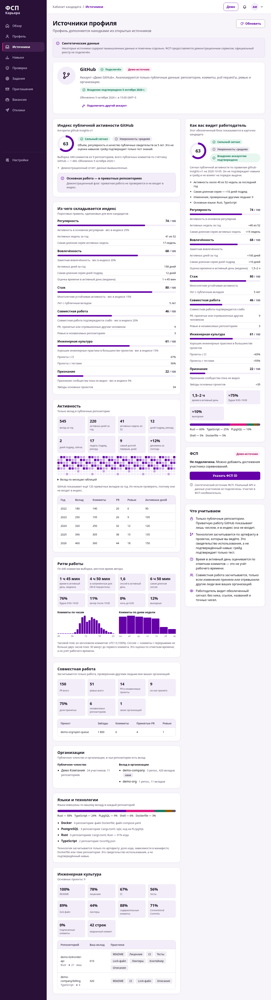

- GitHub: connect by account name (demo, ownership not checked); then found / processed / queued / unavailable
  counts, «Обновить», progress while the job runs, a retryable failure message, and a paged repository table with
  technologies and state.
- ФСП: «Указать ФСП ID»; then verified participation with the synthetic competitions, «Истории ФСП нет» (valid), or
  a temporary-failure message that is explicitly not «no history».
- «Что учитываем»: contribution of the connected account, active days, observation period; working hours are not
  measured.
- Connecting needs processing consent; all data is labelled synthetic.

### `/candidate/skills` — «Навыки и подтверждения»

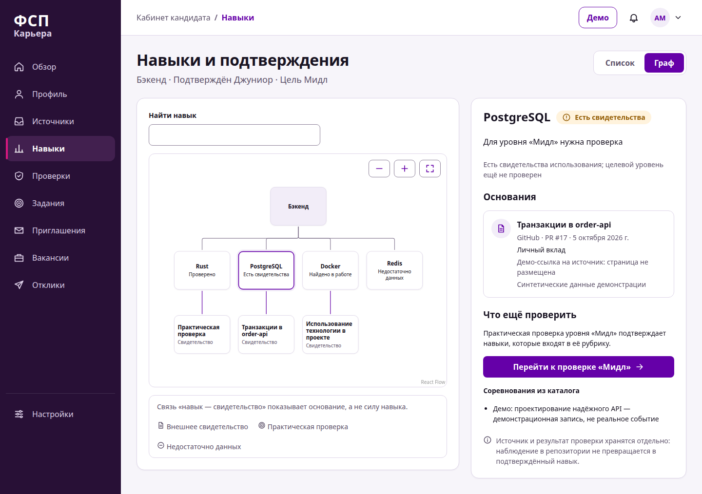

«Список» or «Граф» (kept in the URL), a filter, and an inspector for the selected skill or evidence: state, the level
it was confirmed for and what the target still needs, evidence items with source, date, individual or team scope and
links (demo links as text, assessment evidence links to its result), and «Что ещё проверить» with the check and
catalog competitions. The graph and the list share one selection; the graph has zoom and fit controls and a legend.
Without skills: an empty state with «Подключить GitHub» and «Пройти проверку».

### `/candidate/assessments` — «Проверки»

«Как устроена проверка» (task family and variants, server draft, explanation, AI allowed, failure and service-error
rules, cooldown length from the server, no checks below the verified grade, supported scopes), «Следующий шаг», and
«История попыток»: date, target and variant, status, effect on the category («Джуниор → Мидл», «Грейд сохранён»,
«Без изменений, штрафа и ожидания нет»), «Продолжить» or «Подробнее».

### `/candidate/assessments/{id}/workspace` — practical check

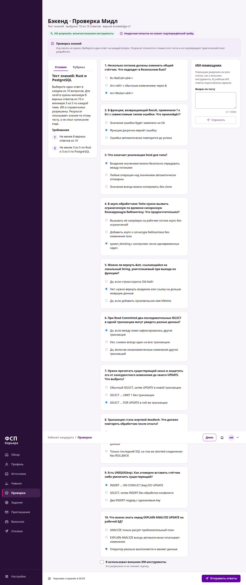

- Header with steps «Условие», «Решение», «Объяснение», and badges «ИИ разрешён, включая внешние инструменты» and
  «Неудачная попытка не снизит подтверждённый грейд»; a warning that code is not executed in the demo.
- Task panel with the prompt, requirements and the rubric with weights.
- Code editor with line numbers; checks with «Запустить проверки» and per-criterion results; explanation with the
  «Я использовал внешние ИИ-инструменты» checkbox.
- «ИИ-помощник» panel; demo answers are labelled.
- Footer: draft status («Черновик сохранён в …», «Есть несохранённые изменения», save error with «Повторить») and
  «Отправить решение», which asks for confirmation and requires code and explanation.
- An attempt that is already submitted shows a link to its result instead of the editor.

### `/candidate/assessments/{id}/result` — result

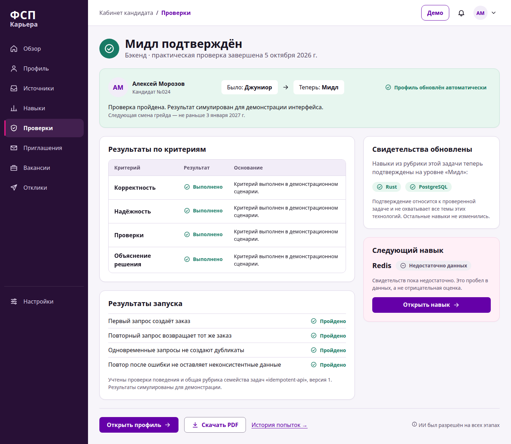
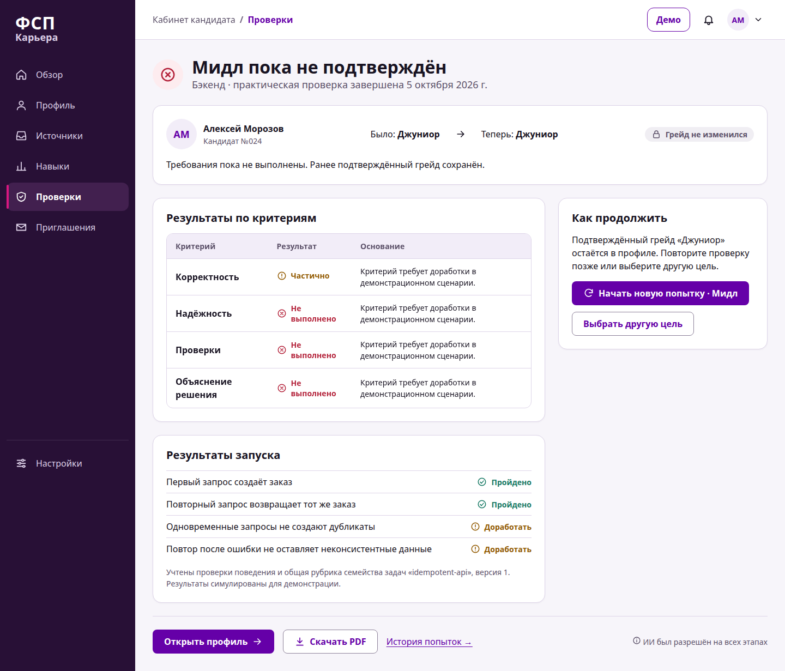

While evaluating: «Решение проверяется», polled until final. Then «Мидл подтверждён» / «… подтверждён повторно» /
«Мидл пока не подтверждён» / «Проверка не пройдена» / «Оценка не получена», with «Было» and «Теперь», «Профиль
обновлён автоматически» after a grade change, feedback, the next possible grade change, rubric results and check
results. Next steps depend on the outcome: retry, choose another target, open the profile, «Скачать PDF», and the next
skill gap.

### `/candidate/invitations` — «Приглашения»

Tabs «Все», «Ждут решения», «Принятые», «Отклонённые и отозванные» (kept in the URL), each invitation with company,
need, salary with tax basis, work mode, date, status and «Новое». Refreshed when the window regains focus.

### `/candidate/invitations/{id}` — invitation

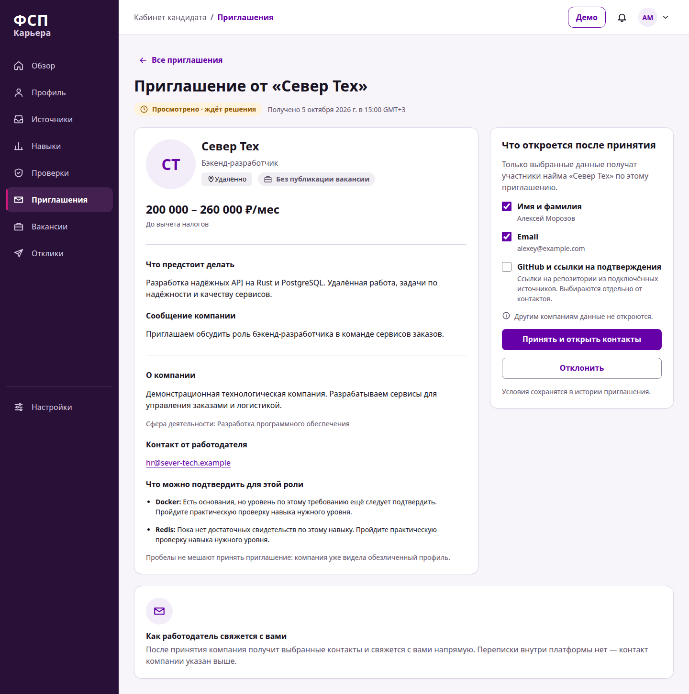
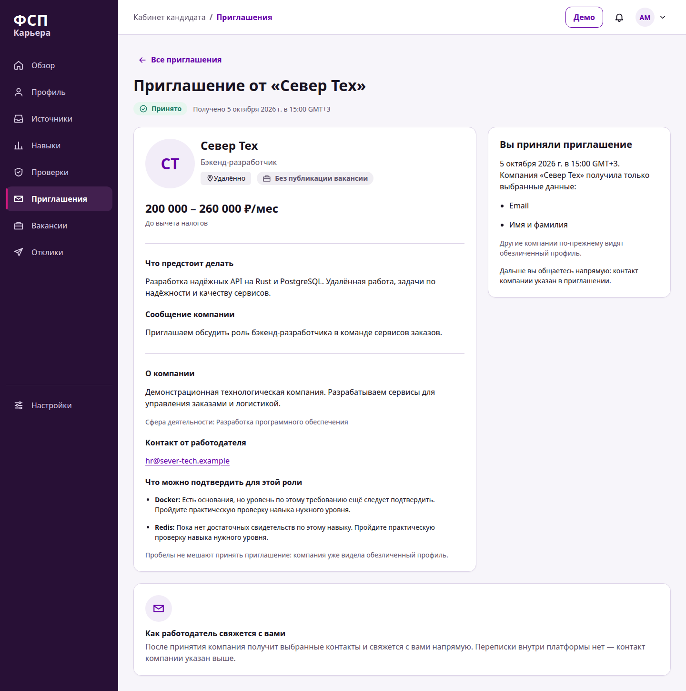

Opening it marks it viewed. Shows the company, need, work mode, «Без публикации вакансии», salary, description,
message, company description, business area and the company's contact, and «Что можно подтвердить для этой роли»
(the gap plan). The decision card selects what to disclose (name and e-mail preselected, source links separately, at
least one required), «Принять и открыть контакты» and «Отклонить» (with confirmation). Accepted, declined and
withdrawn invitations show the outcome and, for acceptance, exactly which fields the company received. A conflict
from another tab shows «Статус уже изменился» and the current state.

### `/candidate/settings` — «Настройки»

Privacy (both consents, how disclosure works, current visibility), sources with their state (disconnecting is not
supported), account e-mail and role, «Выйти».

## Employer

Navigation: Потребности, Кандидаты, Подборки, Приглашения, Компания, Настройки.

### `/employer/needs` — «Потребности»

Needs with specialization, grade, work mode, «Не опубликована — приглашать можно без публикации», salary with tax
basis, required and desired skills and the update date; «Найти кандидатов» (recommended search for the need),
«Редактировать», «Удалить» (with confirmation; sent invitations keep their terms) and «Новая потребность». A new
company sees an empty state with «Описать потребность».

### `/employer/needs/new`, `/employer/needs/{id}` — need editor

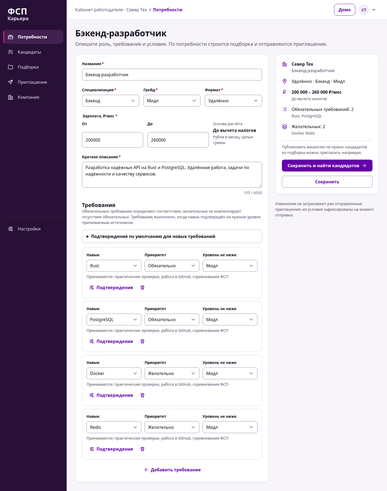

Title, specialization, grade, work mode, salary «от» and «до» in whole rubles per month with the read-only basis «До
вычета налогов», description; requirements with skill, «Обязательно»/«Желательно», minimum level and accepted
evidence (practical checks, GitHub work, FSP competitions — any from the catalog or selected ones), a default policy
that can be applied to all rows, add and remove rows; a live summary. «Сохранить и найти кандидатов» opens
recommended search for the need, «Сохранить» stays. A note says publication is not needed; an incomplete company
profile gets a warning with a link, since invitations need it.

### `/employer/candidates` — «Кандидаты»

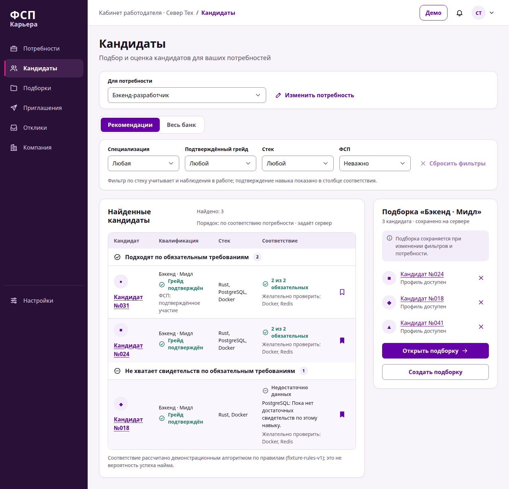
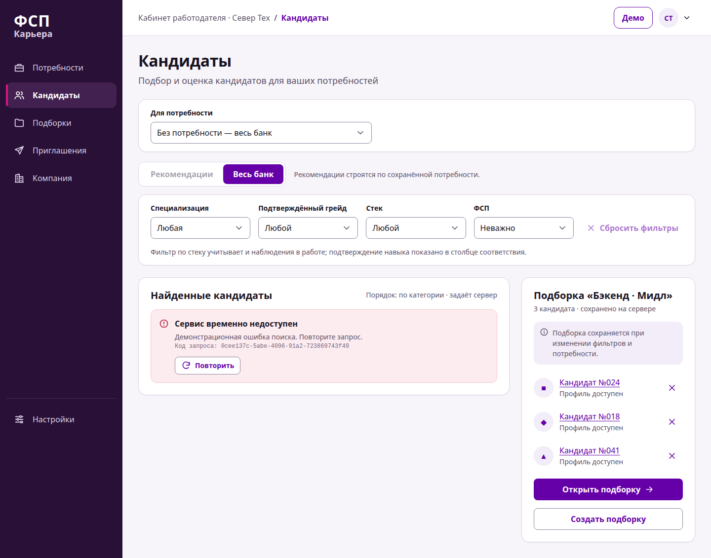

- «Для потребности» selector and mode «Рекомендации» / «Весь банк»; filters for specialization, verified grade,
  stack and FSP. Everything is in the URL.
- Results grouped by match status («Подходят по обязательным требованиям», «Требуют дополнительной проверки», «Не
  хватает свидетельств по обязательным требованиям»), each row with alias, verified qualification and its date, FSP
  participation, stack, required coverage, the first missing requirement with its reason, desired gaps, and a bookmark
  for the active shortlist. The order is set by the server and the page says it is not a probability of hiring.
- Paging; empty results offer «Сбросить фильтры» or «Весь банк»; a search failure is an error state with retry,
  never stale or fixture results.
- Shortlist panel: choose or create a shortlist; members with availability; removal.

### `/employer/candidates/{id}` — anonymous candidate profile

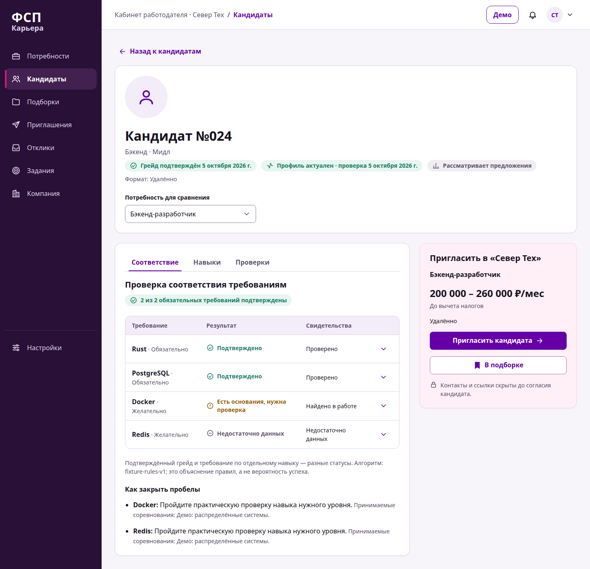
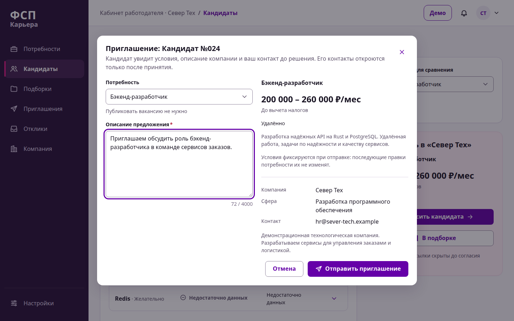
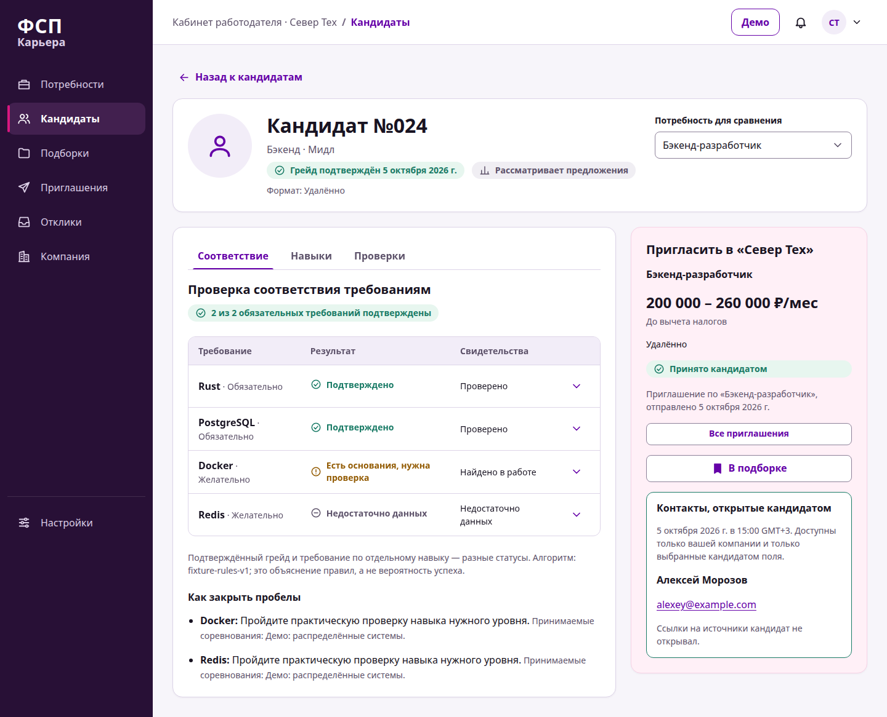

Alias, verified specialization and grade with date, work modes, FSP participation; «Потребность для сравнения»;
tabs «Соответствие» (per requirement: result, evidence state, reason, gap plan), «Навыки» (list or graph without
evidence details) and «Проверки». The contacts card says «Контакты и ссылки скрыты до согласия кандидата» until the
candidate accepts this company's invitation, then shows only the fields they chose. «Пригласить кандидата» opens the
composer: need, offer text, the frozen terms and the company contact the candidate will see; blocked with a link
while the company profile is incomplete; an existing active invitation for the need is reported.

### `/employer/shortlists`, `/employer/shortlists/{id}` — «Подборки»

The list with member counts and update dates, «Создать подборку»; a shortlist page with members (unavailable ones
marked «Профиль недоступен: скрыт или вышел из банка»), removal, rename and delete (the candidates stay in the bank).

### `/employer/invitations` — «Приглашения»

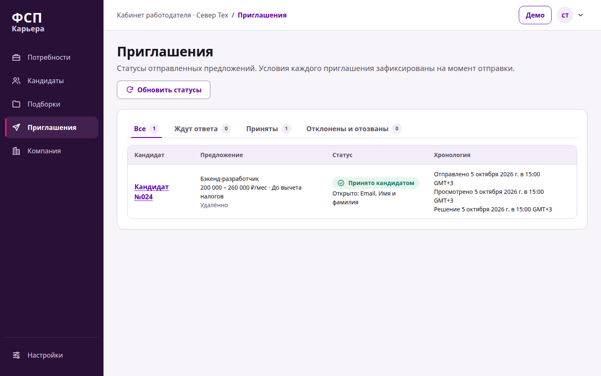

Status tabs (kept in the URL), each invitation with candidate alias, offer and salary, status and a timeline (sent,
viewed, decided), «Отозвать» for open ones (with confirmation; a conflict says the candidate already decided).

### `/employer/company` — «Профиль компании»

Name, business area, description, contact e-mail for candidates, optional website, «Сохранить»; a warning while the
profile is incomplete and «Как видит кандидат» with «Готово к приглашениям». There is no company verification.

### `/employer/settings` — «Настройки»

Account (company, role, whether the e-mail is verified), link to the company profile, «Выйти», and how access to
candidate data works.

## Shared states

Every data view has loading, empty and error states; errors show a human message, the request ID when present and
a retry. «Раздел недоступен» appears when a signed-in user opens the other role's section, «Страница не найдена» for
unknown paths.
